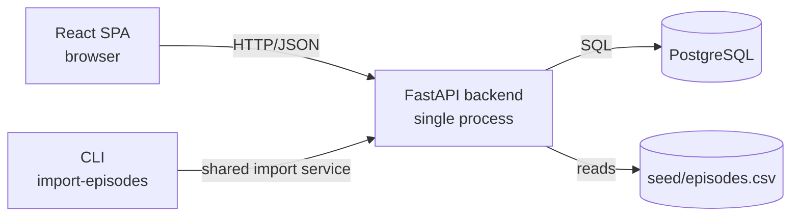
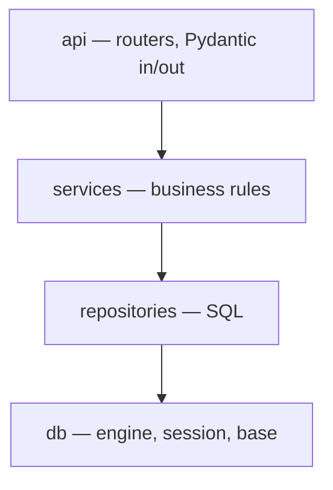

# Architecture

Canonical source for component boundaries, layering, dependency direction, and
cross-cutting concerns. Does not specify endpoints (`API.md`) or columns
(`DATA_MODEL.md`).

Cross-references:
- `API.md` — the HTTP contract.
- `DATA_MODEL.md` — tables, constraints, indexes.
- `DECISIONS.md` — the "why" behind structural choices (referenced by ADR number).
- `GUIDE.md` — engineering rules every contributor follows.

---

## 1. System Overview



ASCII fallback:

```
Browser --HTTP/JSON--> API --SQL--> PostgreSQL
                        ^
                        |
                       CLI  (uses the same import service)
```

Four runtime pieces:

- **React frontend** — runs in the browser. Talks only to the backend over
  HTTP/JSON. Holds no domain logic.
- **FastAPI backend** — a single process. Serves the HTTP API, runs the
  business logic, and owns all database access.
- **PostgreSQL** — a single instance. The only persistent store.
- **CSV import path** — the same `EpisodeImportService` is invoked both by
  `POST /episodes/import` and by `python -m app.cli import-episodes <file>`.

There is no cache, no queue, no worker, no scheduler, and no second service.

---

## 2. Layering

The backend is layered:



ASCII fallback:

```
api  →  services  →  repositories  →  db
```

**Dependency direction is inward only.** A layer may import from the layer to
its right. It may not import from a layer to its left. `services` cannot import
`api`. `repositories` cannot import `services`. Enforced by convention and
review.

**Responsibilities**

| Layer | Owns | Does not own |
|---|---|---|
| `api` | HTTP concerns, Pydantic schemas, status codes, error translation | Business rules, SQL, transactions |
| `services` | Domain rules, state transitions, authorization, transaction boundaries | HTTP status codes, SQL syntax |
| `repositories` | SQL queries, mapping between domain objects and rows | Business rules, transactions |
| `db` | Engine, session factory, transaction context manager | Anything domain-specific |

**Rules**

- Route handlers do three things: parse input, call one service method, format
  the response. No branching on domain rules.
- Business rules live in `services`. If a rule is worth testing on its own, it
  belongs in a service method.
- Repositories do one thing: translate between domain objects and SQL.
- SQLAlchemy models live in `models/` and are importable by both repositories
  and services, but only repositories build queries.
- The `db` module is the single place that knows the database URL, engine
  configuration, and session lifecycle.

---

## 3. Directory Layout

```
backend/
├── app/
│   ├── api/              # FastAPI routers — thin, one per resource
│   ├── core/             # config, security, logging, exceptions
│   ├── models/           # SQLAlchemy models
│   ├── schemas/          # Pydantic request/response models
│   ├── services/         # business logic
│   ├── repositories/     # data access
│   ├── db/               # engine, session, base
│   ├── cli/              # CLI entrypoints
│   └── main.py           # app assembly
├── migrations/           # Alembic
└── tests/

frontend/
└── src/
    ├── api/              # typed API client
    ├── pages/            # route-level components
    ├── components/       # reusable UI
    └── auth/             # token storage and guards
```

The backend is the source of truth for domain rules. The frontend is a client
of the API and holds no domain logic beyond form validation.

---

## 4. Cross-Cutting Concerns

### 4.1 Authentication

- Access tokens are JWTs, signed with a server-side secret, short-lived
  (default 30 min).
- Refresh tokens are opaque, single-use, and stored hashed in `refresh_tokens`.
- A FastAPI dependency (`get_current_user`) verifies the access token and
  returns the user. Missing or invalid tokens raise `AUTHENTICATION_REQUIRED`
  before the service layer is reached.
- The refresh token rotation and revocation logic lives in `AuthService`.

### 4.2 Authorization

Enforced at two checkpoints:

1. **Route-level role check** — a dependency asserts the caller's role is
   permitted for the endpoint.
2. **Object-level check** — inside the service method, after the resource is
   loaded. Example: `RequestService.get_for_user(request_id, user)` returns
   the request only if the caller owns it or has an operational role.

The object-level check is in the service, not the route, because it needs the
loaded resource. Both checkpoints are server-side. Frontend role-based hiding is
UX only.

Visibility rule: when a client requests a resource they do not own, the API
returns `404 NOT_FOUND`, not `403 FORBIDDEN`, to avoid leaking existence.

### 4.3 Transactions

- One service method = one transaction.
- The session is request-scoped, managed by a FastAPI dependency.
- The outermost service method commits on success and rolls back on exception.
  Nested service calls do not commit.
- Repositories never commit.
- Row locks (`SELECT ... FOR UPDATE`) are used where a read-then-write sequence
  must be serialized — see the status transition and assignment paths.

### 4.4 Error Handling

- One exception hierarchy: `AppError` with `code`, `message`, `http_status`,
  and optional `field`.
- Services raise `AppError` subclasses (`NotFoundError`,
  `InvalidTransitionError`, `InsufficientEpisodesError`, …).
- One FastAPI exception handler renders them into the error envelope defined in
  `API.md` §0.4.
- Unexpected exceptions are logged with a stack trace server-side and returned
  as `500 INTERNAL_ERROR` with no internal detail.
- Pydantic validation errors are normalized into the same envelope so all
  failures look alike to the client.

### 4.5 Logging

- One structured logger, configured at startup.
- One middleware emits exactly one log line per request:
  `method`, `path`, `status`, `duration_ms`, `user_id` (when authenticated).
- The following are never logged: passwords, tokens, `Authorization` headers,
  raw request bodies, secrets.

### 4.6 Validation

Two layers, complementary, not redundant:

- **Pydantic schemas** validate shape, types, ranges, and required fields at
  the HTTP boundary.
- **Service-layer rules** enforce domain invariants that require state
  (transitions, assignment eligibility, delivery readiness).

Pydantic accepts a request; the service decides whether the operation is
allowed.

### 4.7 Configuration

- All configuration is environment variables, loaded once at startup into a
  Pydantic settings object.
- Missing required values fail fast at boot — the process exits with a clear
  error rather than running in a broken state.
- Secrets are never defaulted in code. `.env.example` documents the keys; `.env`
  is gitignored.

---

## 5. The Request State Machine

Request status transitions are the operational core of the system. The rules
live in a single module under `services/requests/`.

- The transition table (see `API.md` Appendix A) is expressed as data: a mapping
  from `(current_status, new_status)` to `(required_role, extra_condition)`.
- No `if` chains scattered across route handlers.
- Every transition writes a `request_status_history` row inside the same
  transaction that updates `requests.status`.
- Before deciding, the service re-reads the request with a row lock so two
  concurrent calls cannot both succeed from the same starting status. See
  `DECISIONS.md` (ADR-006).

`accepted` is terminal. Assignments are not cleared on rejection.

---

## 6. The Assignment Concurrency Guarantee

The rule "an episode can belong to at most one active request" is enforced by a
**partial unique index** in the database, not by application logic:

```sql
CREATE UNIQUE INDEX assignments_active_episode_uniq
    ON assignments (episode_id)
    WHERE released_at IS NULL;
```

- The service pre-check (`is this episode already assigned?`) is an optimisation
  for a friendly error message.
- The authoritative guarantee is the index. Two concurrent inserts: one wins,
  the other is caught as an integrity error and returned as a per-episode
  rejection with `reason: "already_assigned"`.
- A partial unique violation never fails the whole batch — the API surfaces it
  per episode and returns `200` with a mixed `assigned` / `rejected` result.

See `DATA_MODEL.md` §3.

---

## 7. The Importer

- One service: `EpisodeImportService`. Used by both `POST /episodes/import` and
  `python -m app.cli import-episodes <file>`.
- The service is transport-agnostic: it takes a stream of CSV rows and returns a
  summary. It knows nothing about HTTP or `argparse`.
- Processing is row-by-row and **partially successful**: valid rows commit,
  invalid rows are reported.
- Idempotent via `UNIQUE(episode_id)` on `episodes`. Re-running the same file
  inserts nothing new.
- The service produces the report structure returned by `API.md` §3.3 and
  printed by the CLI.

The importer is the only place that writes to `episodes` in bulk. Everything
else reads.

---

## 8. The Analytics Path

- Analytics queries live in a dedicated `AnalyticsRepository`, written with
  SQLAlchemy Core or raw SQL — **not** the ORM.
- Reason: the aggregations (`percentile_cont`, `GROUP BY date_trunc`, top-N)
  are clearer and more predictable as SQL than as ORM chains, and analytics
  should never accidentally trigger lazy loads.
- All aggregation is executed in the database. No rows are loaded into Python
  to be summed or medianed.
- The endpoint is read-only and does not open a transaction beyond the default
  request scope.

Scale discussion (indexes, materialised view, partitioning) lives in
`DATA_MODEL.md` §6 and `NOTES.md`.

---

## 9. What Is Deliberately Not Here

These are things a larger system might reasonably need. This system does not,
and adding them would reduce clarity rather than increase it.

- **No message queue** — there are no asynchronous cross-service workflows.
- **No background worker or scheduler** — the only long-running task is CSV
  import, which is synchronous and bounded.
- **No cache layer** — the database is fast enough at this scale; caching adds
  invalidation complexity for no benefit.
- **No CQRS, event sourcing, or separate read/write models** — the read and
  write shapes are the same and the volume does not justify splitting them.
- **No microservices** — one process, one database, one frontend.
- **No service mesh, Kubernetes, or orchestration beyond Docker Compose** — the
  deployment target is a single host running `docker compose up`.

Each of these is a decision that a bigger system might revisit. Nothing in the
current requirements forces them, and every one of them would make the code
harder to review and reason about.