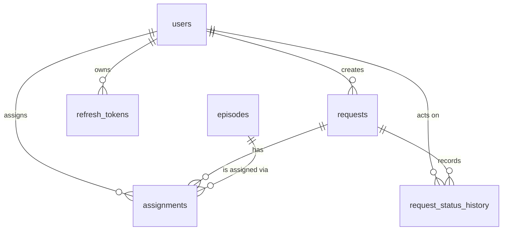

# Data Model

Canonical source for table shapes, columns, constraints, and indexes.
If code and this document disagree, the code is wrong until this file is updated.

Cross-references:
- `API.md` — the HTTP contract that reads and writes these tables.
- `NOTES.md` — the "why" behind structural choices (see the Key Decisions section).
- `ARCHITECTURE.md` — where in the codebase each table is touched.

---

## 1. Entity Relationship Overview



Six tables. No lookup tables. `robot_id` and `operator_name` are denormalised strings sourced from the CSV — they are not foreign keys. See §4.

---

## 2. Tables

### 2.1 `users`

Purpose: application accounts. Roles: `client`, `operator`, `admin`.

| Column | Type | Null | Default | Notes |
|---|---|---|---|---|
| `id` | UUID | no | `gen_random_uuid()` | PK |
| `email` | VARCHAR(255) | no | — | unique, primary identifier |
| `password_hash` | VARCHAR(255) | no | — | bcrypt |
| `role` | VARCHAR(16) | no | — | check: `client` / `operator` / `admin` |
| `name` | VARCHAR(128) | no | — | user's display name |
| `organisation` | VARCHAR(128) | yes | — | client organisation name |
| `is_active` | BOOLEAN | no | `true` | deactivation revokes refresh tokens |
| `created_at` | TIMESTAMPTZ | no | `now()` | |
| `updated_at` | TIMESTAMPTZ | no | `now()` | |

**Constraints**
- PK on `id`
- Unique on `email` (case-sensitive; emails are stored lowercased by the application)
- Check: `role IN ('client', 'operator', 'admin')`

**Indexes**
- `(created_at DESC, id DESC)` — supports `GET /users` sorted listing
- `(role)` — supports `GET /users?role=...`

**Deletion.** Users are never deleted. `is_active = false` is the soft delete.

---

### 2.2 `episodes`

Purpose: one row per robot recording session, imported from CSV.

| Column | Type | Null | Default | Notes |
|---|---|---|---|---|
| `id` | UUID | no | `gen_random_uuid()` | PK, internal only |
| `episode_id` | VARCHAR(64) | no | — | globally unique domain ID from CSV |
| `robot_id` | VARCHAR(64) | no | — | plain string, not a FK |
| `task_name` | VARCHAR(128) | no | — | |
| `recorded_at` | TIMESTAMPTZ | no | — | UTC |
| `duration_seconds` | NUMERIC(10,2) | no | — | check: `> 0` |
| `operator_name` | VARCHAR(128) | yes | — | plain string, may be null |
| `quality` | VARCHAR(16) | no | — | check: `good` / `usable` / `bad` |
| `created_at` | TIMESTAMPTZ | no | `now()` | import timestamp |

**Constraints**
- PK on `id`
- Unique on `episode_id` — the idempotency guarantee for CSV import
- Check: `quality IN ('good','usable','bad')`
- Check: `duration_seconds > 0`

**Indexes**
- `(recorded_at DESC, episode_id DESC)` — unfiltered browse
- `(quality, recorded_at DESC, episode_id DESC)` — filter by quality
- `(task_name, recorded_at DESC, episode_id DESC)` — filter by task
- `(robot_id, recorded_at DESC, episode_id DESC)` — filter by robot

These four indexes exist because every list query on episodes is a keyset scan sorted by `recorded_at DESC, episode_id DESC`, optionally filtered on `quality`, `task_name`, or `robot_id`. Each leading column matches one filter; the trailing two match the mandatory sort + tiebreaker. See `NOTES.md` (Key Decisions — Pagination).

**Deletion.** Episodes are never deleted. Assignments against them may be released, but the episode row remains.

---

### 2.3 `requests`

Purpose: a client's dataset request. Carries the current status.

| Column | Type | Null | Default | Notes |
|---|---|---|---|---|
| `id` | UUID | no | `gen_random_uuid()` | PK |
| `client_id` | UUID | no | — | FK → `users.id` |
| `task_name` | VARCHAR(128) | no | — | |
| `episodes_requested` | INTEGER | no | — | check: `1..100000` |
| `deadline` | TIMESTAMPTZ | no | — | |
| `notes` | TEXT | yes | — | max 2000 chars enforced at API layer |
| `status` | VARCHAR(16) | no | `'submitted'` | check: `submitted` / `in_progress` / `delivered` / `accepted` / `rejected` |
| `created_at` | TIMESTAMPTZ | no | `now()` | |
| `updated_at` | TIMESTAMPTZ | no | `now()` | |
| `delivered_at` | TIMESTAMPTZ | yes | — | set on `in_progress → delivered` |

**Constraints**
- PK on `id`
- FK `client_id → users.id` (no cascade; clients are never deleted)
- Check: `status IN ('submitted','in_progress','delivered','accepted','rejected')`
- Check: `episodes_requested BETWEEN 1 AND 100000`

**Indexes**
- `(created_at DESC, id DESC)` — unfiltered listing
- `(client_id, created_at DESC, id DESC)` — client-scoped listing
- `(status, created_at DESC, id DESC)` — filter by status

**Note.** `episodes_assigned` is **not** a column. It is computed from `assignments` at read time to avoid denormalisation drift.

**Deletion.** Requests are never deleted.

---

### 2.4 `assignments`

Purpose: links an episode to a request. Soft-released, not hard-deleted.

| Column | Type | Null | Default | Notes |
|---|---|---|---|---|
| `id` | UUID | no | `gen_random_uuid()` | PK |
| `request_id` | UUID | no | — | FK → `requests.id` |
| `episode_id` | UUID | no | — | FK → `episodes.id` (internal UUID, not domain ID) |
| `assigned_by` | UUID | no | — | FK → `users.id` |
| `assigned_at` | TIMESTAMPTZ | no | `now()` | |
| `released_at` | TIMESTAMPTZ | yes | — | null = active; set = released |

**Constraints**
- PK on `id`
- FK `request_id → requests.id`
- FK `episode_id → episodes.id`
- FK `assigned_by → users.id`
- **Partial unique index:** `UNIQUE (episode_id) WHERE released_at IS NULL`

The partial unique index is the invariant that makes assignment concurrency-safe. An episode can appear in at most one *active* assignment across all requests. Released rows are excluded, so an episode can be reassigned after release. See §3 and `NOTES.md` (Key Decisions — Assignment concurrency).

**Indexes**
- `(request_id, assigned_at DESC, episode_id DESC)` — list assignments for a request
- `(episode_id) WHERE released_at IS NULL` — the partial unique index above
- `(assigned_at DESC, episode_id DESC)` — global assignment activity (used by analytics and audit)

**Deletion.** Assignment rows are never deleted. Release is `released_at = now()`.

---

### 2.5 `request_status_history`

Purpose: append-only audit trail of every request status transition.

| Column | Type | Null | Default | Notes |
|---|---|---|---|---|
| `id` | UUID | no | `gen_random_uuid()` | PK |
| `request_id` | UUID | no | — | FK → `requests.id` |
| `previous_status` | VARCHAR(16) | yes | — | null on initial `submitted` |
| `new_status` | VARCHAR(16) | no | — | |
| `changed_by` | UUID | no | — | FK → `users.id` |
| `reason` | VARCHAR(500) | yes | — | from the transition request body |
| `changed_at` | TIMESTAMPTZ | no | `now()` | |

**Constraints**
- PK on `id`
- FK `request_id → requests.id`
- FK `changed_by → users.id`
- Check: `new_status IN ('submitted','in_progress','delivered','accepted','rejected')`

**Indexes**
- `(request_id, changed_at DESC)` — fetch history for a request
- `(changed_at DESC)` — global audit queries

**Deletion.** Never. Rows are inserted only, never updated.

---

### 2.6 `refresh_tokens`

Purpose: server-side storage for refresh-token rotation and revocation.

| Column | Type | Null | Default | Notes |
|---|---|---|---|---|
| `id` | UUID | no | `gen_random_uuid()` | PK |
| `user_id` | UUID | no | — | FK → `users.id` |
| `token_hash` | VARCHAR(255) | no | — | SHA-256 of the opaque token |
| `issued_at` | TIMESTAMPTZ | no | `now()` | |
| `expires_at` | TIMESTAMPTZ | no | — | |
| `used_at` | TIMESTAMPTZ | yes | — | set on rotation |
| `revoked_at` | TIMESTAMPTZ | yes | — | set on logout or chain revocation |

**Constraints**
- PK on `id`
- FK `user_id → users.id`
- Unique on `token_hash`

**Indexes**
- `(user_id, expires_at DESC)` — list active tokens for a user (logout-everywhere)
- `(token_hash)` — the unique index above; lookup at `/auth/refresh`

**Deletion.** Tokens are never hard-deleted in the MVP. Expired rows can be pruned by a future background job (documented as out of scope).

---

## 3. The Partial Unique Index

The single most important constraint in the schema:

```sql
CREATE UNIQUE INDEX assignments_active_episode_uniq
    ON assignments (episode_id)
    WHERE released_at IS NULL;
```

**What it guarantees.** An episode can be in at most one active assignment at a time, across all requests. This is the domain rule from the brief ("an episode can belong to at most one active request at a time"), enforced at the database level rather than by application logic alone.

**What would break without it.** Two concurrent operators could both pass an `if not already_assigned` check, both issue an `INSERT`, and the episode would end up in two active requests. The bug is rare in testing and catastrophic in production. See `NOTES.md` (Key Decisions — Assignment concurrency, and Something That Went Wrong) and `API.md` §5.2 for how the API surfaces the resulting conflict.

**Why partial and not a plain unique.** Released assignments must not block reassignment. `WHERE released_at IS NULL` scopes the uniqueness to *active* rows only.

---

## 4. Denormalised Strings

Two columns are deliberately strings rather than foreign keys:

- `episodes.robot_id`
- `episodes.operator_name`

The source CSV carries these as free-form values. There is no requirement in the brief to manage robots or operators as first-class entities, and introducing `robots` / `operators` tables would:

1. Add integrity coupling between importer and a lookup process that doesn't exist.
2. Require inventing placeholder rows during import for unknown values.
3. Add two more tables and two more foreign keys for zero business benefit.

If the domain later requires robots or operators to be managed entities, the migration is: create the table, backfill from `SELECT DISTINCT`, add the FK, drop the string. This is straightforward and doesn't invalidate the current design. Noted in `NOTES.md` as a deliberate simplification.

---

## 5. Index Summary

| Table | Index | Supports |
|---|---|---|
| `users` | `(created_at DESC, id DESC)` | list users |
| `users` | `(role)` | filter by role |
| `episodes` | `(recorded_at DESC, episode_id DESC)` | browse episodes |
| `episodes` | `(quality, recorded_at DESC, episode_id DESC)` | filter by quality |
| `episodes` | `(task_name, recorded_at DESC, episode_id DESC)` | filter by task |
| `episodes` | `(robot_id, recorded_at DESC, episode_id DESC)` | filter by robot |
| `requests` | `(created_at DESC, id DESC)` | list all requests |
| `requests` | `(client_id, created_at DESC, id DESC)` | list a client's requests |
| `requests` | `(status, created_at DESC, id DESC)` | filter by status |
| `assignments` | `(request_id, assigned_at DESC, episode_id DESC)` | list assignments for a request |
| `assignments` | `(episode_id) WHERE released_at IS NULL` | **partial unique** — assignment concurrency guarantee |
| `assignments` | `(assigned_at DESC, episode_id DESC)` | global assignment activity |
| `request_status_history` | `(request_id, changed_at DESC)` | request history |
| `request_status_history` | `(changed_at DESC)` | global audit |
| `refresh_tokens` | `(user_id, expires_at DESC)` | logout-everywhere |
| `refresh_tokens` | unique on `(token_hash)` | token lookup |

Uniqueness indexes (`episode_id` on episodes, `username` on users, `token_hash` on refresh_tokens) are implied by their UNIQUE constraints and are not repeated here.

---

## 6. Scale Notes (5M Episodes)

At ~5 million episodes:

- **Storage.** Each row is ~150 bytes → ~750 MB of table data, ~1.5 GB with indexes. Well within a single Postgres instance.
- **Browse query** (`GET /episodes` with no filter). Uses `(recorded_at DESC, episode_id DESC)`. A keyset scan reads one index range — the depth of pagination does not affect cost, unlike `OFFSET`.
- **Filtered browse.** Uses the composite indexes above. `quality` has three distinct values, so a `quality=good` filter over 5M rows still returns ~1.5M candidates — the index narrows the scan but Postgres may still walk a large range. This is expected and acceptable for a browse endpoint.
- **Analytics aggregation** (`episodes_by_day_robot` over a wide range). This is the heaviest query. It is a full scan of the date range, grouped and counted. At 5M rows over a year, this takes seconds. Two scale paths are documented but not implemented:
  1. **Materialised view** refreshed hourly, with the analytics endpoint reading from it.
  2. **Monthly partitioning** on `episodes` by `recorded_at`, so a range query only scans the relevant partitions.
- **`COUNT(*)` cost.** Deliberately not exposed. `total` would require counting the filtered set on every page, which defeats keyset pagination.

These considerations are also summarised in `NOTES.md` under "Scale."

---

## 7. Migration Discipline

- Every schema change goes through Alembic. No manual DDL.
- One migration per logical change. Do not bundle unrelated changes.
- Migrations must be reversible, or explicitly marked irreversible with a comment explaining why.
- Data migrations (backfills, transformations) are separate from schema migrations.
- Never edit a committed migration. Corrections are new migrations.
- Migrations run automatically on container startup in development. In any deployed environment, migrations are a separate, explicit step.

---

## 8. Deletion Behaviour Summary

| Table | Deleted? | Notes |
|---|---|---|
| `users` | No | Soft delete via `is_active` |
| `episodes` | No | Append-only after import |
| `requests` | No | Never removed, even if rejected and abandoned |
| `assignments` | No | Soft release via `released_at` |
| `request_status_history` | No | Append-only audit trail |
| `refresh_tokens` | No | Expiry-driven; a future job may prune |